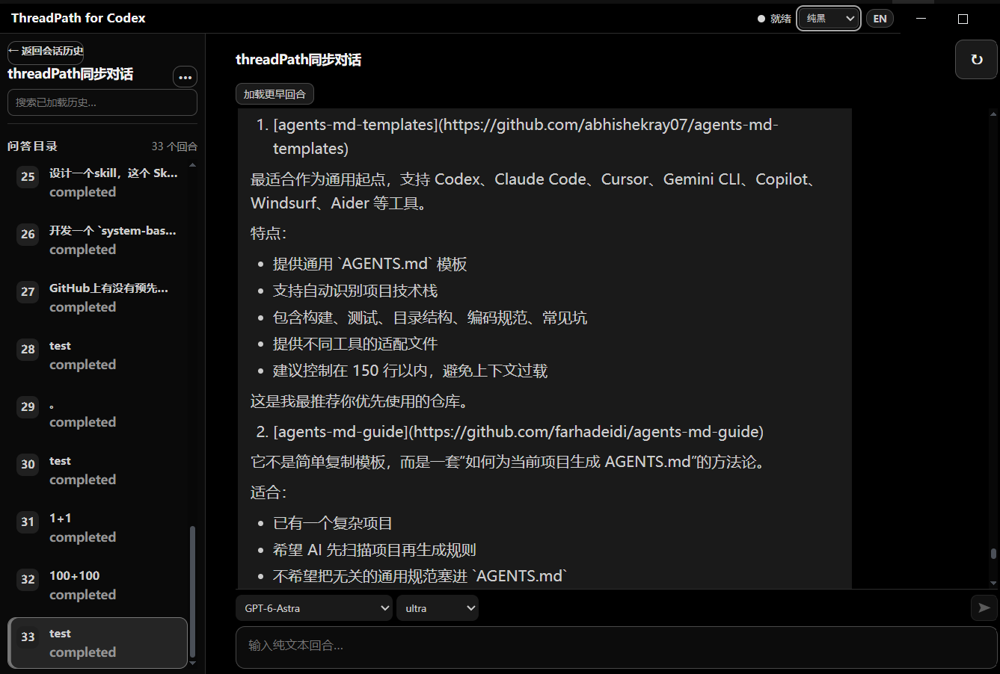
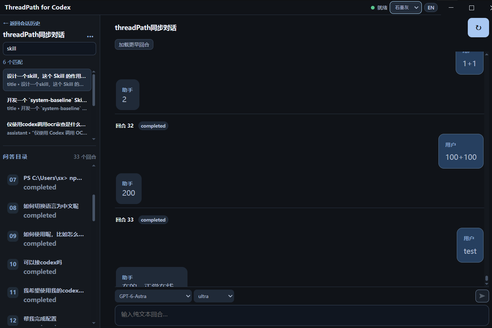
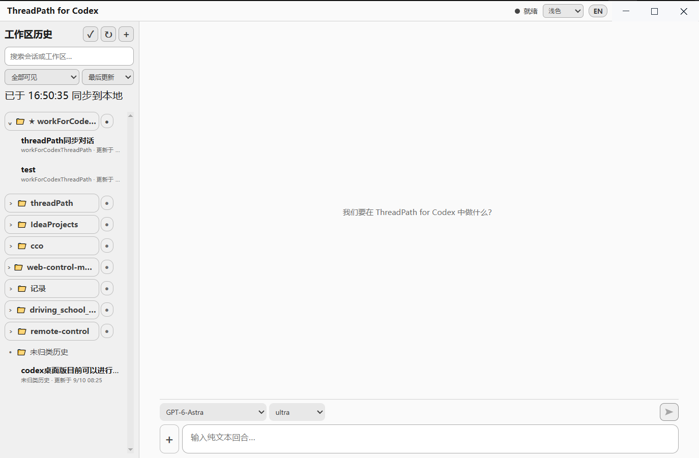
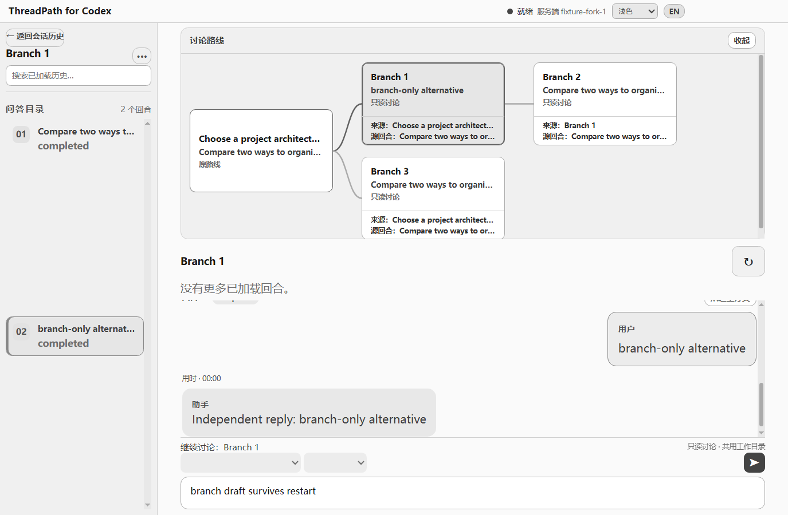

# ThreadPath for Codex

> 与 Codex 官方客户端并行使用的会话历史与工作区管理桌面工具。
> A desktop companion for browsing and organizing Codex history and workspaces alongside the official client.

[](https://github.com/hufangyuan460-blip/threadpath-for-codex)
[](https://github.com/hufangyuan460-blip/threadpath-for-codex/releases)

## 产品定位

ThreadPath 不替代 Codex 官方客户端，而是它的本地历史管理伴侣：在官方客户端中完成日常编码、审批和关键操作；在 ThreadPath 中同步、搜索、浏览和整理会话与工作区。

- 从本地 Codex CLI `app-server` 读取已同步的会话和工作目录；
- 以工作区分组、搜索、收藏、隐藏和本地命名整理历史；
- 首页输入框显示当前工作区名称；支持归档到 Codex 历史并从“已归档”恢复；
- 提供回合目录、Markdown 阅读、分页与虚拟列表，适合长会话回溯；
- Token Usage 展示服务器报告的累计用量、最近快照和已观察压缩；它不是精确 Context Occupancy，不估算占用百分比或剩余上下文。[语义与限制](docs/token-usage-observatory.md)。
- 仅在确认工作目录且服务器确认线程可写时允许发起或续聊，避免与其他客户端争用写入；
- 收藏、隐藏、命名等整理偏好保存在 ThreadPath 本地；归档和恢复通过 Codex 协议同步实际会话状态。

当前版本为 `v0.1.0-beta.4`。点击左上角产品名可在「关于」查看应用版本、源码提交号和构建状态。需要已安装并完成认证的 Codex CLI；Windows x64 安装包不包含 CLI、未签名，也暂未提供自动更新。

## 界面预览

**黑色主题**



**石墨灰主题**



**浅色主题**



## 技术栈

- **桌面端：** Electron、Vite、React、TypeScript；
- **会话协议：** Codex CLI `app-server`、stdio、JSONL / JSON-RPC；
- **长会话体验：** `react-virtuoso` 虚拟列表、安全 Markdown 渲染；
- **构建与质量：** pnpm、Node.js 24、NSIS、GitHub Actions、fake app-server E2E。

## 获取与运行

从 [GitHub Releases](https://github.com/hufangyuan460-blip/threadpath-for-codex/releases) 选择已公开的 Windows x64 安装包及对应构建清单、SHA-256 校验文件。先安装并认证 Codex CLI，再启动 ThreadPath。应用会自动发现 CLI；找不到时可手动选择 `codex.exe` 与工作目录。Windows 可能对未签名程序显示安全提示，请先核对来源与校验值。

开发环境：

```powershell
pnpm install --frozen-lockfile
pnpm typecheck
pnpm test
pnpm build
pnpm package:win
```

真实协议验证依赖本机登录状态与网络：

```powershell
pnpm smoke
```

## 当前 Beta 功能与后续展望

Beta.4 汇总 Beta.3 后的改进：支持「不在工作区工作」的独立会话入口、区分用户与模型的消息目录、Token Usage 与已观察压缩展示，并修复未知终态被当作成功、稀疏历史与分页重读丢失已接受输入等问题。分支继续共用源工作目录并要求只读策略；归档/恢复与来源导航保留现有语义。[中英文发布说明](docs/releases/v0.1.0-beta.4.md)。

Usage 是服务器绝对快照，重启后未知，不代表精确上下文占用或费用；历史压缩项不能推断实时生命周期。真实 fork Usage 继承和实时压缩完整生命周期尚未验证（`M6_C4_FULL_LIFECYCLE: INCOMPLETE`）。[验收范围](docs/m6-c4a-resume-usage-report.md)。

Beta.3 增加版本识别与发布核对：每个版本都有独立安装包、构建清单和 SHA-256 校验文件。发布前核对源码标签并在实际打包程序上执行固定验收；维护者操作见 [发布流程](docs/release-process.md)。

2026-10-12 更新的 Beta 安装包包含分支讨论闭环：在已结束回合点击「从这里分支」，得到继承至该回合的新对话；通过卡片与连线切换原路线、同级分支和嵌套分支。输入区显示当前续聊对象，各会话草稿与分支关系在重启后恢复。

卡片显示来源会话与源问题，点击来源直接回到分叉回合；分支正文标出继承历史和新增讨论的分界。分叉点位于更早页面时会自动加载，缺失或读取失败会明确提示并允许重试。

当前 Beta 更新已接入编织图标，并修复首页新建后因历史索引延迟退回首页的问题；核对与验证见 [修复记录](docs/desktop-fixes-2026-10-12.md)。

新分支共用源会话的工作目录，按只读讨论模式续聊；每次发送前要求 Codex 确认只读策略。具体操作、验证范围和限制见 [分支讨论说明](docs/branch-conversation.md)。完整验收命令为 `pnpm test:e2e`。



后续优先观察真实使用中是否减少重复描述上下文、方案混杂和找不到原路线的问题，再决定比较或工作目录隔离等功能的必要性。

## English

ThreadPath is a local companion to the official Codex client, not a replacement. Use the official client for day-to-day coding and approvals; use ThreadPath to synchronize, search, read, and organize Codex history and workspaces.

It connects to the local Codex CLI `app-server`, keeps workspace organization preferences locally, and allows sending only after a working directory and a writable thread have been confirmed. The current version is `v0.1.0-beta.4`. Select published Windows x64 installers from [GitHub Releases](https://github.com/hufangyuan460-blip/threadpath-for-codex/releases). Install and authenticate Codex CLI separately; the unsigned installer does not bundle it or provide auto-updates. Click the product name at the top left for the version and source commit.

Beta.4 adds standalone conversations outside project workspaces, role-aware message navigation, and server-reported Token Usage/observed compaction, plus history pagination and uncertain-terminal reliability fixes. Usage is not exact context occupancy or cost; snapshots are in memory only. Real fork Usage inheritance and the full live compaction lifecycle remain unverified. See the [bilingual release notes](docs/releases/v0.1.0-beta.4.md) for evidence boundaries and upgrade notes.

The stack is Electron, Vite, React, TypeScript, the Codex `app-server` over stdio JSONL/JSON-RPC, `react-virtuoso`, pnpm, NSIS, and GitHub Actions. Near-term work focuses on reliability, complete history synchronization, performance, and accessibility before advanced workspace and conversation views.

## License

License terms have not been finalized.
许可证尚未最终确定。
