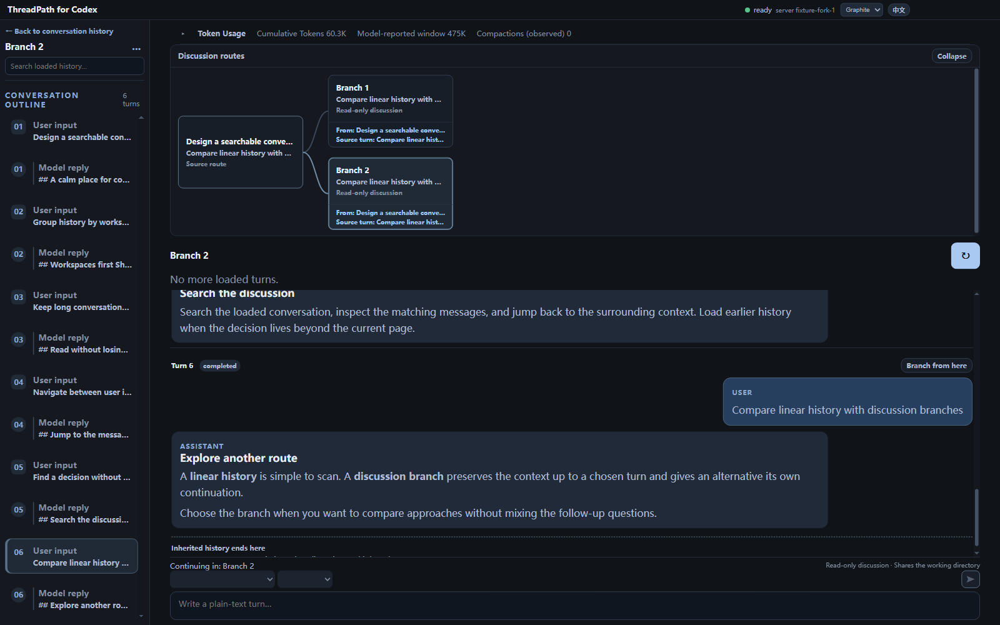
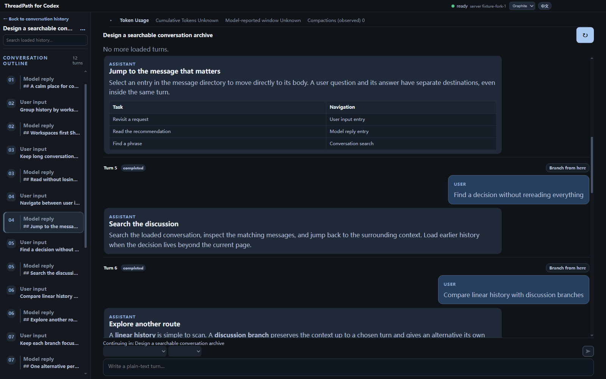
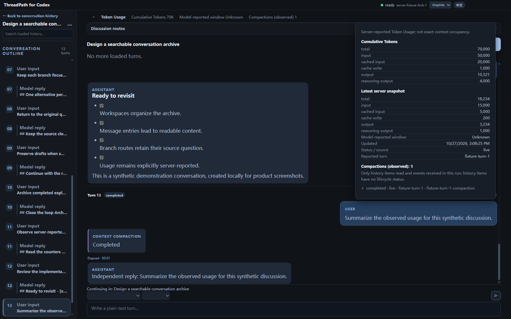
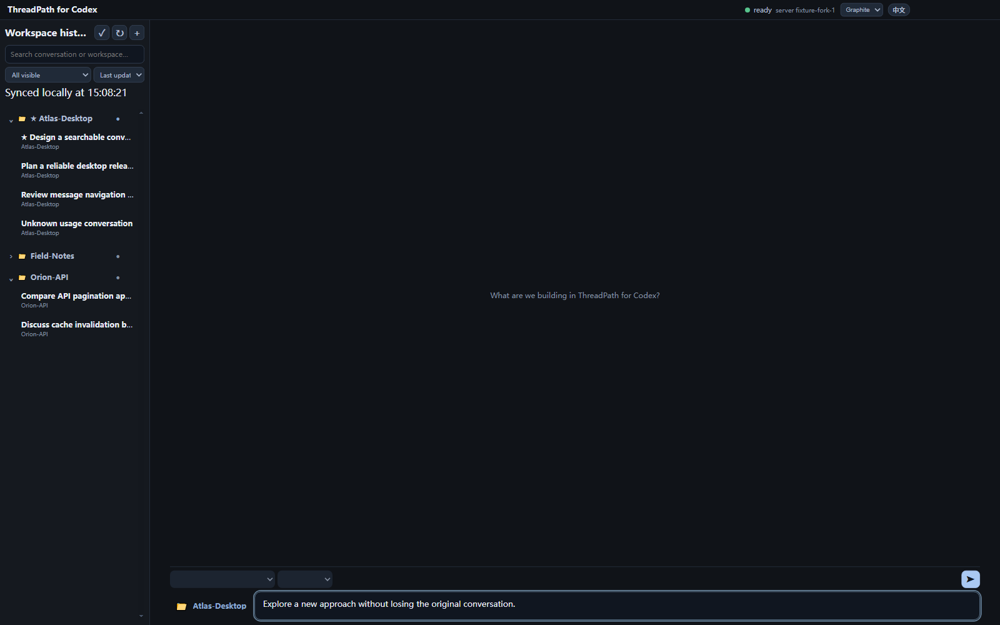

# ThreadPath for Codex

**一个帮助开发者浏览、组织和分支探索 Codex 会话历史的 Windows 桌面伴侣。**

A Windows desktop companion for browsing, organizing, and exploring branches of your Codex conversation history.

[](https://github.com/hufangyuan460-blip/threadpath-for-codex/releases/tag/v0.1.0-beta.4)
[](https://github.com/hufangyuan460-blip/threadpath-for-codex/releases)

[下载 / Download](https://github.com/hufangyuan460-blip/threadpath-for-codex/releases/tag/v0.1.0-beta.4) · [发布说明 / Release notes](docs/releases/v0.1.0-beta.4.md) · [快速开始 / Getting started](#getting-started--快速开始)

讨论变长、项目变多后，不必从头翻找每个决定：按工作区找到历史，跳到具体消息，再从已结束回合分出一条替代方案路线。

Find the project, jump to the message, and explore an alternative from a completed turn—without losing the original discussion.

ThreadPath **不替代官方 Codex 客户端**。日常编码、审批和关键操作仍可在官方客户端完成；ThreadPath 通过本地 Codex CLI `app-server` 帮助你回看与整理历史。

ThreadPath works alongside the official Codex client. Keep using it for everyday coding and approvals; connect ThreadPath to the local Codex CLI `app-server` to revisit and organize your history.

## In the app / 界面预览

以下均为当前 Beta.4 代码构建的真实 Electron 应用截图，使用石墨灰主题与合成演示会话，不含私人历史。
Screenshots use synthetic demonstration conversations in the actual Beta.4 app, with the Graphite theme.

### Explore a branch / 分支探索

从历史问题分出讨论路线，查看来源关系与当前路线；分支共用源工作目录，以只读讨论模式继续。
Explore alternatives from a historical question. The route map shows their source and your current route; branches share the source directory and continue as read-only discussions.



### Navigate a long conversation / 长会话导航

用户输入和模型回复分别进入消息目录，点击后定位正文；Markdown、表格和回合上下文一起保留。
Jump separately to user inputs and model replies, with Markdown, tables, and the surrounding turns in view.



### Observe usage / 用量观测

查看服务器累计用量、最近快照、状态与已观察压缩。图中数值来自合成服务端通知；它们不是精确上下文占用率或费用。
Inspect cumulative usage, the latest server snapshot, status, and observed compactions. These demonstration values come from synthetic server notifications, not estimates of context occupancy or cost.



### Organize workspaces / 工作区与历史

工作区默认折叠，只展开需要的项目。首页列出工作区历史；打开会话后，左栏切换为消息目录。
Projects start collapsed; expand the ones you need. The home view lists workspace history, and opening a conversation changes the sidebar to its message directory.



## Key Features / 主要功能

| 能力 / Feature | 使用方式 / What you can do |
| --- | --- |
| 工作区与历史 / Workspaces & history | 按项目分组、检索、收藏、本地命名与隐藏。Group by project, search, star, rename locally, and hide entries. |
| 长会话阅读 / Long conversations | 分页加载、虚拟列表、用户/模型消息目录，检索已加载正文。Page through history, navigate user/assistant messages, and search the loaded transcript. |
| 讨论分支 / Discussion branches | 从已结束回合创建分支，通过路线图切换并返回来源问题，各会话保留草稿。Branch from completed turns, switch routes, revisit the source question, and keep separate drafts. |
| Token Observatory | 展示服务端 total/last 快照及已观察压缩，没有数据时显示未知。View server-reported total/last snapshots and observed compactions; missing data stays unknown. |
| 归档与恢复 / Archive & restore | 通过 Codex 归档、保留历史阅读、恢复后续聊；区别于本地隐藏。Archive through Codex, keep history readable, and restore to continue; local hiding is separate. |

## Installation / 安装

从 [Beta.4 Release](https://github.com/hufangyuan460-blip/threadpath-for-codex/releases/tag/v0.1.0-beta.4) 下载 Windows x64 安装器，并核对同版 `SHA256SUMS.txt` 与 `build.json`。其他已公开版本见 [全部 Releases](https://github.com/hufangyuan460-blip/threadpath-for-codex/releases)。

Download the Windows x64 installer from the [Beta.4 release](https://github.com/hufangyuan460-blip/threadpath-for-codex/releases/tag/v0.1.0-beta.4). Check its SHA-256 against that release's checksum file and build manifest.

- **前置条件 / Prerequisites：** Windows x64；单独安装并完成认证的 Codex CLI；使用模型时需要可用网络。Install and authenticate Codex CLI separately; model operations need network access.
- **当前分发方式 / Distribution：** 安装器不包含 CLI，暂未代码签名，也没有自动更新。The installer does not bundle the CLI, is unsigned, and has no auto-updater.

## Getting Started / 快速开始

1. 安装并认证 Codex CLI，然后安装、启动 ThreadPath。Install and authenticate Codex CLI, then install and launch ThreadPath.
2. 应用自动发现本地 CLI；若失败，在引导中选择 `codex.exe` 并确认工作目录。Let the app discover the CLI, or select its executable and confirm a working directory during setup.
3. 同步历史，展开一个工作区，打开会话；使用消息目录或搜索定位内容。Sync history, expand a workspace, and open a conversation. Use its message directory or search to find a passage.
4. 在已结束回合点击「从这里分支」，探索替代方案，并通过路线图回到源问题。Select **Branch from here** on a completed turn to explore an alternative and follow the map back to its source.

没有已有历史也可以开始使用：先选工作区新建会话，或选择「不在工作区工作」使用应用独立目录。发送与续聊需要确认工作目录和线程可写状态。

An empty history is supported. Start a new conversation in a selected workspace, or choose **Work outside a workspace** to use an app-owned directory. Sending requires a confirmed directory and writable thread state.

## Privacy & Limitations / 隐私与限制

- **本地伴侣 / Local companion：** 应用连接本机 CLI，整理偏好和草稿保存在本地；草稿为本地明文。模型请求仍由 Codex CLI 按其配置发送至服务提供方。The app connects locally and stores organization preferences and plaintext drafts locally; Codex CLI sends model requests to its configured provider.
- **分支边界 / Branch scope：** 分支共用源目录，要求服务器确认只读策略；不提供文件快照、目录隔离或分支合并。Branches share the source directory and require server-confirmed read-only policy; file snapshots, directory isolation, and branch merging are unavailable. [详细说明 / Details](docs/branch-conversation.md)
- **观测边界 / Observatory scope：** Usage 不是精确 Context Occupancy、剩余上下文或费用；快照只存内存，重启后未知，单纯浏览历史可能没有用量。历史压缩项不能证明实时生命周期。Usage is not exact occupancy, remaining context, or cost. Snapshots are memory-only and may be absent when browsing history. Historical compaction items do not prove a live lifecycle. [语义与验证范围 / Semantics and evidence](docs/token-usage-observatory.md)
- **Beta 状态 / Beta status：** 真实 fork Usage 继承及完整实时压缩生命周期仍未验证；本版尚未验收实际 NSIS 安装/卸载流程。Real fork Usage inheritance and the complete live compaction lifecycle remain unverified; actual NSIS install/uninstall flows have not been validated for this version. [已知限制 / Known limitations](docs/releases/v0.1.0-beta.4.md#known-limitations--已知限制)

## Development / 开发

Node.js 24 + pnpm 11.7.0。桌面端使用 Electron、React、Vite 和严格 TypeScript；协议层通过 stdio JSONL 连接 Codex `app-server`。
The desktop uses Electron, React, Vite, and strict TypeScript, with a stdio JSONL protocol layer for Codex `app-server`.

```powershell
pnpm install --frozen-lockfile
pnpm dev
```

离线验证与构建 / Offline checks and build:

```powershell
pnpm typecheck
pnpm test
pnpm test:e2e
pnpm build
```

E2E 使用合成 app-server，不调用真实模型。截图重现方法见 [截图说明](docs/screenshots/README.md)。
E2E runs against synthetic app-servers without real model calls. See [screenshot capture](docs/screenshots/README.md) for reproducible previews.

[发布流程 / Release process](docs/release-process.md) · [协议原型 / Protocol prototype](threadpath-protocol/README.md) · [路线图 / Roadmap](README-ROADMAP.md)

## License / 许可证

许可证尚未最终确定，仓库当前没有项目 `LICENSE` 文件；不宣称已采用任何开源许可证。
License terms have not been finalized. There is currently no project `LICENSE` file, and no open-source license is claimed.
