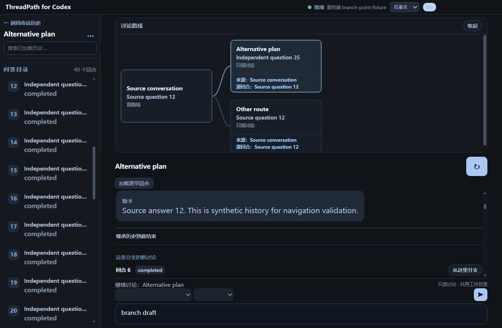

# 分支讨论闭环

日期：2026-10-12。开发增量已验证，并纳入本次 GitHub Beta 安装包更新。任务门禁已在实现前完成：`READY_TO_CODE`。

## 需求与取舍

用户要在真实讨论中从同一上下文探索不同方案，保留原路线，并能看清现在在哪条路线续聊。此次授权覆盖历史回合分支、卡片连线导航、明确发送目标、逐会话草稿和重启恢复。更完整的 Electron 架构、DAG 多父节点、比较、合并、数据库和云同步不属于此次交付。

适用用户指令优先于 `AGENTS.md` 中旧的「仅协议原型」阶段描述；已读取现有桌面实现并复用连接管理、工作目录身份、锁和 JSON 偏好文件。开始时工作区已有上一轮协议验证修改，均保留。共享约束见 [开发基线](development-baseline.md)，协议证据见 [分支协议验证](protocol-fork-verification.md)。

替代方案是只做静态路线图，或复制文本模拟分支；前者无法独立续聊，后者不能可靠继承模型上下文。本次采用已实测的 `thread/fork + lastTurnId`。用确定性树布局绘制现有关系，不新增图形库。

## 使用

1. 打开历史会话并确认工作目录。源会话空闲、工作目录锁可用时，在已结束回合点击「从这里分支」。截止回合也包含在新会话中，之后的源历史排除。
2. 创建成功后自动选中新分支；点击路线卡片返回原路线或其他分支，也可继续从分支创建嵌套分支。当前卡片与祖先路径高亮。卡片底部显示来源会话与源问题，点击来源直接回到原会话的分叉回合，支持键盘 Enter。
3. 输入区显示「继续讨论：会话名称」。每条路线有独立草稿；发送失败保留文本，服务器接受发送后清除对应草稿。
4. 分支正文在截止回合后显示「继承历史到此结束」，第一个新增回合显示「这条分支的新讨论」。若截止回合在更早页面，点击「查看继承历史分界」会自动加载并定位；截止回合未加载时不会猜测分界。
5. 关闭并重新打开应用后，从历史列表选择会话，恢复该会话所属路线图、名称与草稿，以及来源跳转入口。路线图可以收起，在小窗口中也可滚动。

分支失败时保留原路线和草稿。若服务器已创建分支但本地写入失败，提示导航数据可能没有保存；不自动重试创建，避免重复分支。

## 调用路径与持久化

`Conversation / BranchMap → preload → conversation:fork → reconcileThread → WorkspaceLockService → ConversationService.forkConversation → AppServerClient.forkThread`。

主进程在 fork 成功后记录关系、截止回合、短标签、本地名称和安全历史元数据。`CodexHistorySyncService` 保留有明确本地关系的源会话和分支，即使本次完整列表未返回它们，也继续显示缺失标记；不可读取的会话仍会明确报错。

`drafts:get/set` 按会话 ID 读写现有用户数据目录中的 `threadpath-ui.json`。保存上限为每条草稿 100000 字符；写入队列避免并发覆盖，临时文件替换避免正常写入过程留下半个 JSON，正常退出会等待队列。草稿以本地明文保存，不上传。偏好文件不保存完整对话正文；分支标签与已有历史预览仍可能包含简短文本。

旧偏好文件缺少新字段时正常加载；损坏的分支或草稿字段被单独过滤，既有名称与语言保留。回退 UI 不需要迁移 Codex 会话或删除已创建分支，新增偏好字段可保留。

## 只读策略与范围

分支共用源会话的实际工作目录，不代表回到该时刻的文件状态。创建时发送只读策略，每次续聊再次请求只读 `thread/resume`，客户端检查返回策略；缺失或非 `readOnly` 时阻止模型回合。未知版本通过真实 RPC 判断兼容性，不把缺省能力列表当作已验证支持。

同时运行的会话、外部写入与未知工作目录状态仍受现有检查和锁约束。源会话行为延续现有规则。本轮未验证长历史性能、多次压缩、所有 CLI 版本，也不提供文件快照、分支代码隔离或对话合并。

## 验收证据

| 检查 | 结果与证据 |
| --- | --- |
| 严格类型与构建 | `pnpm typecheck`、`pnpm build` 通过；协议目录 `npx tsc --noEmit` 通过 |
| 离线回归 | `pnpm test` 通过；新增截断、失败重试、进行中回合、只读覆盖、错误父节点、并发草稿、偏好重载、同步期间保留分支、祖先投影与损坏循环测试 |
| 既有桌面路径 | `desktop.e2e.ts` 全部 17 场景通过，含导航、搜索、发送、失败、中断、外部写入和终态恢复 |
| 新桌面路径 | `branches.e2e.ts` 通过：截止后历史排除、独立发送、同级/嵌套分支、草稿切换、实际 Electron 重启、关系与草稿恢复、失败不丢草稿、只读确认失败时不发送 |
| 布局 | 中文/英文、石墨灰/浅色、760×480 最小窗口检查通过；截图使用合成会话，输入区保持可见 |
| 真实基础协议 | 改动后 `npm run smoke` 通过；Responses 重试回退 HTTP 后完成，未把网络等待归类为握手失败 |
| 真实分支与只读恢复 | 本机 CLI `0.162.0-alpha.17.2` / Node `v24.19.0`；关闭压缩的 `npm run smoke:fork` 7 项通过，独立上下文和重启只读续聊均成功，2 个专用测试会话全部归档。脱敏报告位于忽略目录 `artifacts/branch-readonly-report.json` |

上一轮完整压缩验收的 10 项结果仍见协议验证文档；本次补验没有再次声称验证压缩。桌面测试用 fake server，不依赖认证与网络；真实协议测试只操作新建专用会话。以上结果限定本机环境，不是跨版本保证。

执行 `pnpm test:e2e` 会先构建，再运行既有桌面套件、分支套件和分叉点导航套件。截图见 [讨论路线](screenshots/branch-routes.png)。

## 分叉点导航增量：上下文与验收

2026-10-12，用户明确要求落实来源追溯与继承分界。实现前核对 `AGENTS.md`、基线 `DATA-004/005`、现有 `Conversation`、`BranchMap`、分页服务与 E2E，门禁为 `READY_TO_CODE`；已有未提交修改全部保留。

范围限定来源展示、定位和正文分界，不引入协议方法或新存储字段。卡片以源会话名称和源问题摘要标识来源；跳转只使用既有 `sourceThreadId` 与 `forkTurnId`。回合显示编号可能随加载更早页面变化，不用编号或相同问题文字猜测目标。此选择避免保存过时的分页相对编号，无偏好文件迁移。

调用路径：`BranchMap 来源按钮 → App 的定位目标 → readThread → locateBranchPoint → 必要的 loadMoreTurns → Conversation / Virtuoso`。复用现有只读 IPC，不调用 `thread/resume` 或 `turn/start`。已加载正文按稳定截止 ID 判断继承区间，不创建额外虚拟回合，也不影响目录与搜索的回合身份。

替代做法是切换源会话后停在最新位置，或按摘要搜索；前者仍需手动回溯，后者可能命中重复问题。本次采用稳定 ID 定位；更早页面自动查找，游标重复或读取错误进入可重试错误状态，完整历史仍找不到目标时提示缺失。路由切换取消旧定位，迟到响应不覆盖新路线。删除本增量即可回退，不影响已有 Codex 会话、分支记录与草稿。

调试中发现，首次挂载时立即调用虚拟列表滚动方法可能先高亮目录却未滚动正文。定位目标现在也作为列表初始显示位置；E2E 同时断言目标回合在正文视口内，不能只凭目录高亮或 DOM 中存在节点判定成功。

增量验收：

- `branch-navigation.test.ts`：多页查找、游标不前进、读取错误、错误线程、取消、缺失目标、无新增回合及未知分界。
- `branch-points.e2e.ts`：60 回合源会话、47 回合分支；正常多页跳转、分页失败重试、源回合缺失、快速切换取消、错误源线程响应拒绝；来源入口可键盘操作，草稿保持，继承与新增边界正确。记录的请求确认导航仅读取历史。
- `branches.e2e.ts`：补验无新增回合提示、首次独立续聊标签，以及 Electron 重启后仍能通过来源入口定位且草稿保留。
- `pnpm typecheck`、`pnpm test`、`pnpm test:e2e`：通过。新增逻辑未修改协议客户端，也未追加真实模型回合；上一轮真实协议结果仍保留原验证范围。

本轮验证的是有限合成历史与用户操作正确性，不是长历史性能或所有协议版本保证。无法读取的源回合会明确提示，不自动跳到相近回合或修改历史。

