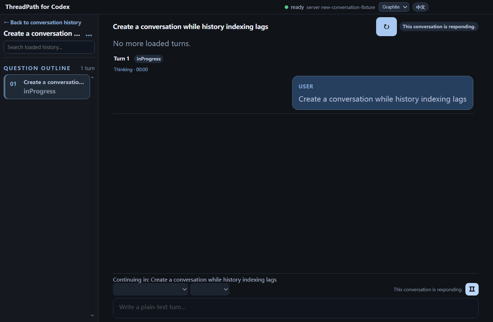

# 图标与首页新会话修复

日期：2026-10-12。任务范围：核对远程差异、更新应用图标、修复首页创建会话后的导航，并验证重新打包的产物。实现前完成 `READY_TO_CODE` 门禁，保留既有分支与协议修改。

## 远程差异

以下表格记录首次修复时的状态。随后用户授权提交、推送及更新 GitHub 安装包；发布前已快进整合 `origin/main` 的这两项提交，并保留全部本地功能。初始化弹窗和新版 CLI 发现逻辑已接入最终构建；窗口图标格式冲突保留远程格式，资源编辑开关保留本次修复。启动失败 E2E 改为使用初始化弹窗中的“重试检测”，而非被弹窗遮挡的页脚按钮。

通过 `git fetch origin` 核对：本地 `HEAD` 为 `8e27872`，远程 `origin/main` 为 `f52229f`。远程新增两项提交，涉及 10 个文件；本地还包含本轮之前未提交的分支讨论、来源导航与协议验证增量。

| 远程提交 | 内容 | 本次处理 |
| --- | --- | --- |
| `dbee105` | 初始化界面与 CLI 自动发现；涉及 discovery、renderer 和样式 | 已检查差异，保留为独立待同步变更 |
| `f52229f` | 编织图标资源、生成脚本、打包与窗口图标配置 | 引入相同 SVG/PNG/ICO 和脚本，应用于本地配置与窗口 |

使用逐文件读取与补丁接入图标更新，没有整批替换本地 renderer 或主进程文件，也没有创建提交、合并分支或推送远程。Git 提交关系仍有上述差异；图标资源的工作区内容已接入。

## 图标修复

旧本地包缺少远程图标资源，使用 Electron 默认图标。另一个配置问题是 `win.signAndEditExecutable: false` 会让 electron-builder 跳过主 EXE 的资源编辑，即使已指定 `win.icon`，也不足以保证程序文件图标改变。

现在启用 EXE 资源编辑，分别配置应用、安装器和卸载器图标；通过 `extraResources` 带入运行时 ICO，`BrowserWindow` 在开发和打包环境分别读取正确路径。图标来自远程现有设计，没有重新绘制。

## 首页跳转修复

之前创建成功后立即调用历史同步，renderer 根据新快照是否包含当前 ID 来决定是否清除选中会话。Codex 的历史列表尚未收录新线程时，这会把页面退回首页。原 E2E 的 fake server 立即返回新线程，未覆盖这个触发条件。

新逻辑以创建返回的会话 ID 为导航依据，列表缺失不能覆盖成功结果。主进程在回复创建结果前，把安全元数据加入已有历史镜像；显式本地工作目录关联参与镜像保留，保证索引暂时缺失的会话在刷新和重启后仍能导航。此类会话仍标记缺失，读取失败会明确报错；没有伪造服务器已完成索引的状态。

复用现有 IPC、JSON 偏好文件与历史同步，不增加数据库或协议方法。回退可撤销这些局部行为，不删除 Codex 会话或用户草稿。

## 验证

新增模拟服务始终返回空 `thread/list`，同时支持已创建线程的读取。`new-conversation.e2e.ts` 检查首页自动进入新会话、流式回复、缺失索引不清除选择、回到历史仍能找到会话，以及实际 Electron 重启后的会话和草稿恢复。测试也可通过 `THREADPATH_PACKAGED_EXE` 对解包后的实际 EXE 执行。

类型、离线测试与完整桌面 E2E 已通过。打包完成后额外核对应用与安装器的 PE 图标资源、运行时 ICO、ASAR 中的当前代码，并以实际打包 EXE 重跑首页测试。导航与新建测试使用合成会话，不访问真实用户认证或模型服务。

本轮没有修改协议实现，上一轮真实协议验收保持原范围。未更新版本号或发布远程安装包。

本机产物核对：主程序与安装器均包含源 ICO 的 7 个尺寸图像，运行时 `resources/icon.ico` 一致，ASAR 中主进程、preload 和 renderer 文件与当前构建逐一一致。源 SVG/PNG/ICO 与 `origin/main` 字节一致。

实际 `release/win-unpacked/ThreadPath for Codex.exe` 的首页新建、索引持续缺失、历史恢复与进程重启测试也通过。安装器生成成功，未自动安装到用户系统。图标与跳转修复首包 SHA-256 为 `bb616b24c1ee8dc52705b1c047f8255c5f8be64c58c53c5621d9d50fe8d4b94b`；首条消息补修后的当前包见下文。

本环境把 `ELECTRON_BUILDER_CACHE` 指向项目内 `.electron-builder`。工具包中的 macOS 符号链接曾因 Windows 权限导致解压失败；使用已下载工具的 Windows 组件准备本地缓存，并复用已有 NSIS 缓存后打包成功。这是本机工具缓存处理，不代表所有 Windows 环境都会遇到相同问题；没有关闭 EXE 图标资源编辑来绕过失败。

本机再次打包可复用缓存：

```powershell
$env:ELECTRON_BUILDER_CACHE = "D:\threadPath\.electron-builder"
pnpm package:win
```

## 首条消息显示补修

随后用户反馈：首页跳转已正常，但首条用户消息要手动刷新才出现。实现前核对创建、历史读取和通知路径，增量门禁为 `READY_TO_CODE`。问题在于此前只补齐服务器完全遗漏的回合；服务器已返回回合 ID、但消息正文仍为空时，本地已接受的输入被稀疏快照覆盖。

`ConversationService` 现在在创建或续聊成功后保留已接受输入，按会话与稳定回合 ID 跟踪等待正文的状态。重复空读取、部分正文、分页或提前完成不会丢掉输入；服务器返回包含原输入的用户正文时，去掉本地占位消息并使用服务器消息 ID，避免重复气泡。确认后历史恢复为权威来源，不永久复活已删除内容。

这些状态只存在于服务已有内存视图中，不把消息正文写入 UI 偏好文件；服务关闭时清除。未修改协议或增添网络调用。

增量测试包括完成早于首次读取、空用户占位、部分文本、反复空历史、不同服务器消息 ID 的去重，以及确认后内容移除。新建 E2E 将服务器正文隐藏 60 秒，同时仍返回回合 ID；断言首条用户消息无需刷新即出现在正文视口内、完成后仍存在、稀疏刷新不重复、重启后服务器内容只显示一次。

保留消息仅用于展示。状态协调继续依据原始服务器快照中的活动回合，不能把等待正文的本地占位回合当成活动写入者；补验了漏终态恢复后的连续续聊，避免显示修复影响发送锁。

首条消息补修已通过类型检查、桌面离线测试、完整 `pnpm test:e2e`，并在实际打包 EXE 上通过相同正文延迟测试。包内文件与当前构建一致，程序与安装器图标仍通过 7 尺寸资源对照。当前安装包 SHA-256 为 `c4fe0765b8151e770771d6ff46f42dd02c0ce325f0831f764e7fea5d08571ebf`。截图使用合成消息：



## 提交前最终整合产物

2026-10-12：整合远程初始化与 CLI 发现改动，重新执行类型检查、离线测试和完整桌面 E2E。最终安装器重新构建并通过实际 EXE 的目录/归档和首条消息测试；ASAR 文件与当前构建一致、7 种图标尺寸核对通过。最终安装器 SHA-256：`59a43aed478562cd6de3d63991b283094eb30ec8687feb1872e6d4fbe4ca0461`，取代此前同名本地构建。
