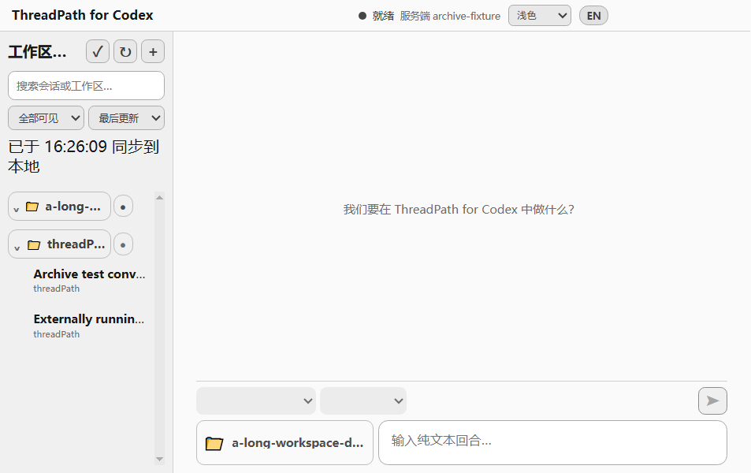
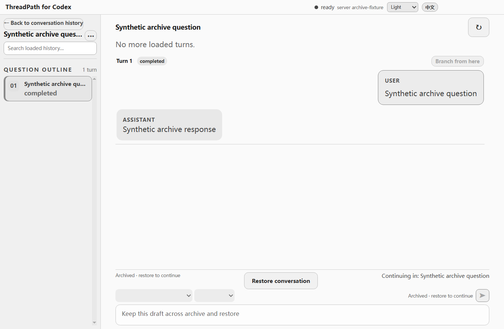

# 首页工作区与会话归档

日期：2026-10-12；本次为现有桌面 Beta 的增量，不更改 Codex 配置或认证。

## 使用方式

- 首页输入框左侧显示文件夹图标和当前工作区名称；长名称省略，悬停或无障碍名称可查看完整路径。点击仍可切换或添加目录。沿用工作区按 Git 根目录归组的现有规则。
- 历史会话和会话页左侧的 `···` 菜单都有“归档会话”。成功后从常用历史移除；在会话页执行时返回首页。
- 历史筛选选择“已归档”，可以打开会话阅读。菜单或输入框上方“恢复会话”可恢复，随后可以续聊。
- 归档保留 Codex 正文，以及 ThreadPath 的草稿、名称、收藏、目录关联和分支关系。归档状态写入 Codex；已有“隐藏会话”仍只是本地展示偏好。
- 归档视图也显示隐藏工作区中的归档会话，避免无法恢复；全局搜索可以找到归档会话。其他常用筛选排除归档会话。

## 实现边界

preload 通过类型化 `threads:set-archived` IPC 调用主进程；主进程先取得现有工作目录锁并只读核对活动状态，再调用 `AppServerClient.archiveThread/unarchiveThread`。正在回复、无法读取或协议操作失败时不伪造成功，也不发起模型回合。已归档会话的发送和分叉在主进程同样拒绝，必须恢复后操作。

归档状态由已核实的 `thread/list` 筛选补全，因为 `Thread` 不保证返回 `archived`。操作成功后安全历史镜像立即更新；未被索引确认的状态覆盖迟到扫描，确认后继续接受其他客户端修改。操作成功但偏好保存失败时保留内存状态并显示保存提示。没有新增正文存储或偏好迁移。

## 验证结果

- `pnpm typecheck`、`pnpm test`：通过；覆盖协议参数、能力缺失、服务端错误、格式错误响应、过滤状态补全、归档/恢复索引延迟及安全镜像。
- 完整 `pnpm test:e2e`：通过；原有桌面 17 场景、分支闭环、来源定位 5 场景、首条消息，以及新增工作区和归档测试。
- 新增 `workspace-archive.e2e.ts`：覆盖目录选择与切换、长名称、中文浅色最小窗口、两处归档入口、读取与恢复、主进程活动阻止、失败不改列表、索引延迟、重启与草稿保留。使用隔离 userData 和合成内容。
- 新增 E2E 文件按仓库 Bundler/严格 TypeScript 设置独立检查：通过。
- `npm run smoke`：通过；本机 Responses WebSocket 超时重试后回退 HTTP 成功，不能将传输重试归为协议失败。
- 本机 CLI `0.162.0-alpha.17.2` / Node `v24.19.0`：有正文专用只读测试会话的归档、两类列表、归档读取与分页、恢复及普通列表恢复均通过，结束后归档本次会话。报告 `artifacts/archive-live-report.json` 不含正文。无回合空线程的 archive/unarchive 与归档读取也成功，但恢复的空线程未立即出现在普通列表；不能用空会话替代有正文恢复验收。
- Windows 新包验收：通过；直接启动 `release/win-unpacked/ThreadPath for Codex.exe` 重跑工作区/归档及首条消息测试，均成功。ASAR 内 5 个运行文件与当前构建逐字节一致；主 EXE、安装器 7 种尺寸图标及运行时 ICO 核对通过。

最新安装包：`release/ThreadPath for Codex Setup 0.1.0-beta.1.exe`；SHA-256：`59a43aed478562cd6de3d63991b283094eb30ec8687feb1872e6d4fbe4ca0461`。版本号沿用当前 Beta，本地产物已覆盖前次同名修复包。

专项上下文见 [任务上下文](workspace-archive-context.md)。

## GitHub 发布整合

发布前保留远程 `dbee105` 的初始化与 CLI 发现修复，以及 `f52229f` 的编织图标。按协议、桌面功能、打包修复、测试适配、发布文档拆分中英文 Conventional Commits。沿用现有 `v0.1.0-beta.1` Release 更新安装器资产与说明，不重写已发布标签。正式安装包基于整合后的源码重新构建；最终校验值以上面的最新安装包记录为准。

整合远程改动后再次执行 `pnpm typecheck`、`pnpm test` 和完整 `pnpm test:e2e`，全部通过；重新生成的包再次通过实际 EXE 的工作区/归档与首条输入测试、ASAR 文件一致性和图标验证。
